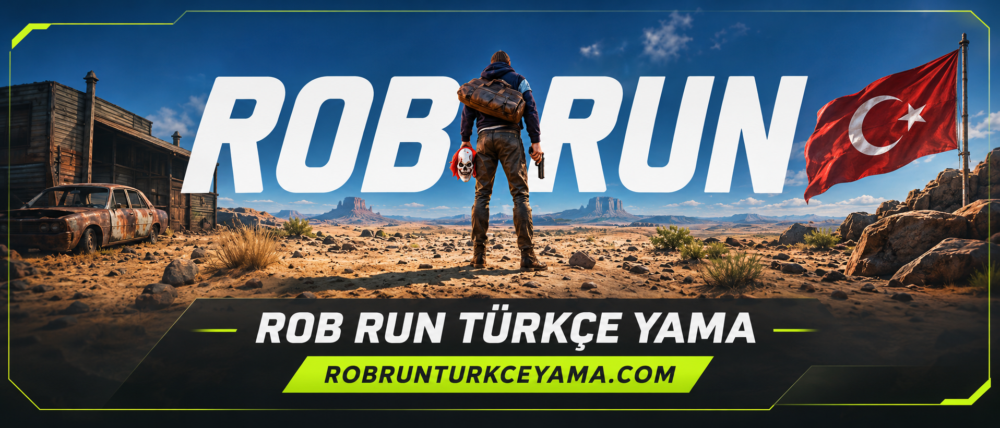

<p align="center">
  
</p>

<p align="center">
  <a href="https://robrunturkceyama.com/"></a>
  <a href="https://github.com/ICESTARONLINE/ROBRUN-TURKCE-YAMA/releases/latest"></a>
  <a href="LICENSE"></a>
</p>

<p align="center">
  <strong>Steam oyunu ROB RUN için açık kaynak, ücretsiz Türkçe dil yaması kurucusu.</strong><br>
  <sub>Kefir, Steam veya Valve ile bağlantılı değildir · resmi olmayan hayran çalışması · ICESTAR</sub>
</p>

| | |
|---|---|
| **Ürün** | ROB RUN Türkçe Yama |
| **EXE** | `ROBRUN_TR.exe` |
| **Yayıncı (proje)** | ICESTAR |
| **Site** | https://robrunturkceyama.com/ |
| **GitHub** | https://github.com/ICESTARONLINE/ROBRUN-TURKCE-YAMA |

<br>

## 

1. ROB RUN klasörünü seçersin (veya otomatik bulunur; içinde `ROB RUN.exe` olmalı).
2. Uygulama yazılacak yolları onaylatır, bütünlüğü doğrulanmış worker’ı çalıştırır.
3. Türkçe metin/font Addressables verisi şuraya yazılır:

   `%USERPROFILE%\AppData\LocalLow\Kefir\ROB RUN\com.unity.addressables\`

4. **Steam oyun klasöründeki dosyalar kurulum hedefi değildir.** Eski oyun-içi yama yedeği varsa geri alınabilir.
5. **Kaldır** ile Türkçe önbellek paketleri silinir (`--kaldir`).

Yönetici (UAC) istemez (`asInvoker`).

<br>

## 

- Windows 10/11 x64
- Steam’de ROB RUN kurulu
- Kurulum/kaldırmadan önce oyunu kapat

<br>

## 

### Önkoşullar

- [.NET 9 SDK](https://dotnet.microsoft.com/download)
- WinUI için Visual Studio 2022 / Windows SDK
- Python 3.12+ (`tr_cache_worker.exe` yeniden derlemek için)
- `installer/PatchData/` içinde yama dosyaları (`installer/PatchData/README.md`, `OPEN_SOURCE_AUDIT.md`)

### Worker

```powershell
cd tools/tr_worker
python -m venv .venv
.\.venv\Scripts\Activate.ps1
pip install -r requirements.txt
pyinstaller tr_cache_worker.spec
Copy-Item .\dist\tr_cache_worker.exe ..\..\installer\PatchData\ -Force
```

### Kurucu EXE

```powershell
cd installer
dotnet publish .\RobRunTurkceYama.csproj -c Release -r win-x64 -p:Platform=x64 --self-contained true -o ..\publish_out
# Çıktı: ..\publish_out\ROBRUN_TR.exe
```

veya:

```powershell
cd installer
.\publish_release.ps1
```

### Doğrulama

```powershell
Get-FileHash ..\publish_out\ROBRUN_TR.exe -Algorithm SHA256
```

<br>

## 

- **Özgün proje kodu/dokümanları:** MIT — `LICENSE` (kapsam sınırlı)
- **Oyun varlıkları / PatchData bundle’lar:** MIT **değil** — `THIRD_PARTY_NOTICES.md`, `OPEN_SOURCE_AUDIT.md`

<br>

## 

`SECURITY.md`, `PRIVACY.md`, `CODE_SIGNING_POLICY.md`

<br>

## 

`ROBRUN_TR.exe` şu an **dijital olarak imzalanmamıştır**. Bu yüzden Windows Defender SmartScreen veya antivirüs “Bilinmeyen yayıncı” / “Windows bilgisayarınızı korudu” uyarısı gösterebilir. Bu, yamanın otomatik olarak zararlı olduğu anlamına gelmez; imzasız yazılımda sık görülür.

---

<p align="center">
  
</p>

Unofficial **Turkish localization helper** for the Steam game **ROB RUN**.

| | |
|---|---|
| **Product** | ROB RUN Türkçe Yama |
| **EXE** | `ROBRUN_TR.exe` |
| **Publisher (project)** | ICESTAR |
| **Site** | https://robrunturkceyama.com/ |
| **GitHub** | https://github.com/ICESTARONLINE/ROBRUN-TURKCE-YAMA |

This is **not** affiliated with Kefir, Steam, or Valve.

<br>

## 

1. Select (or auto-detect) the ROB RUN install folder (`ROB RUN.exe`).
2. Confirm write scope, then run an integrity-checked worker.
3. Write Turkish Addressables data to:

   `%USERPROFILE%\AppData\LocalLow\Kefir\ROB RUN\com.unity.addressables\`

4. Steam game binaries are not the install target; legacy in-folder backups may be restored.
5. Uninstall removes Turkish cache packages via `--kaldir`.

No admin UAC (`asInvoker`).

<br>

## 

- Windows 10/11 x64
- ROB RUN installed via Steam
- Close the game before install/uninstall

<br>

## 

### Prerequisites

- [.NET 9 SDK](https://dotnet.microsoft.com/download)
- Visual Studio 2022 / Windows SDK (WinUI)
- Python 3.12+ (to rebuild `tr_cache_worker.exe`)
- Patch files under `installer/PatchData/` (`installer/PatchData/README.md`, `OPEN_SOURCE_AUDIT.md`)

### Worker

```powershell
cd tools/tr_worker
python -m venv .venv
.\.venv\Scripts\Activate.ps1
pip install -r requirements.txt
pyinstaller tr_cache_worker.spec
Copy-Item .\dist\tr_cache_worker.exe ..\..\installer\PatchData\ -Force
```

### Installer EXE

```powershell
cd installer
dotnet publish .\RobRunTurkceYama.csproj -c Release -r win-x64 -p:Platform=x64 --self-contained true -o ..\publish_out
# Output: ..\publish_out\ROBRUN_TR.exe
```

or:

```powershell
cd installer
.\publish_release.ps1
```

### Verify

```powershell
Get-FileHash ..\publish_out\ROBRUN_TR.exe -Algorithm SHA256
```

<br>

## 

- Original project code/docs: MIT — `LICENSE` (scoped)
- Game assets / PatchData bundles: **not** MIT — `THIRD_PARTY_NOTICES.md`, `OPEN_SOURCE_AUDIT.md`

<br>

## 

See `SECURITY.md`, `PRIVACY.md`, `CODE_SIGNING_POLICY.md`.

<br>

## 

`ROBRUN_TR.exe` is **not code-signed**. Windows Defender SmartScreen or antivirus may show “Unknown publisher” / “Windows protected your PC”. That is common for unsigned software and does not by itself mean the file is malware.
